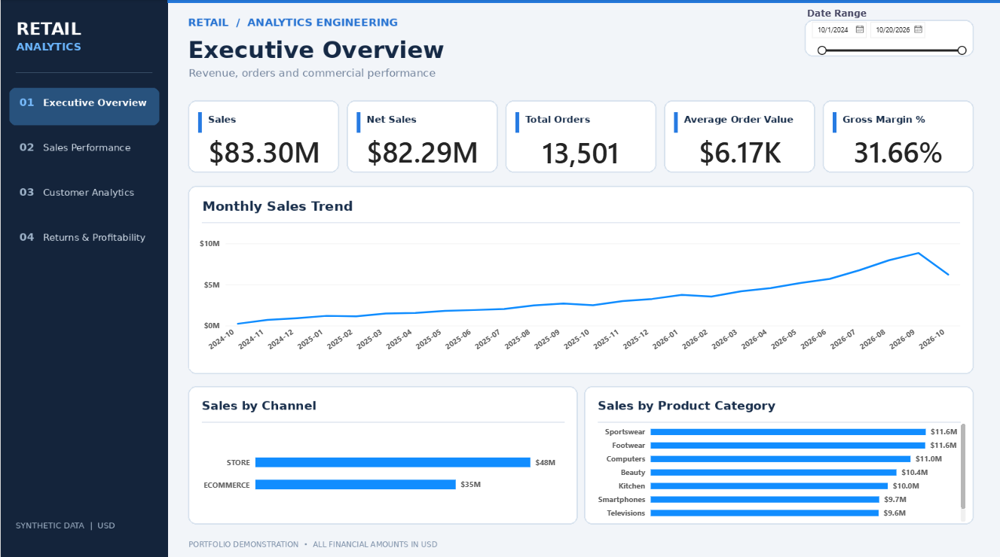
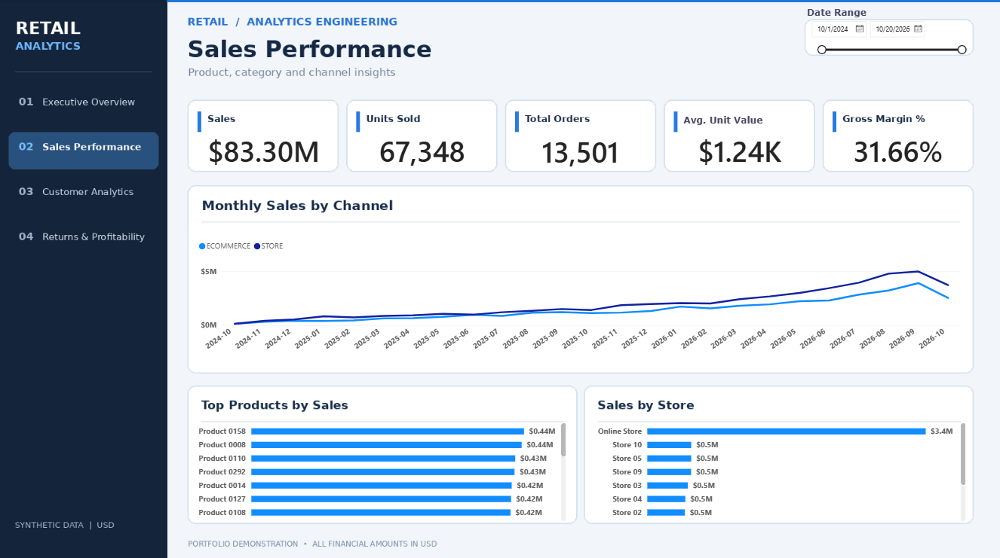
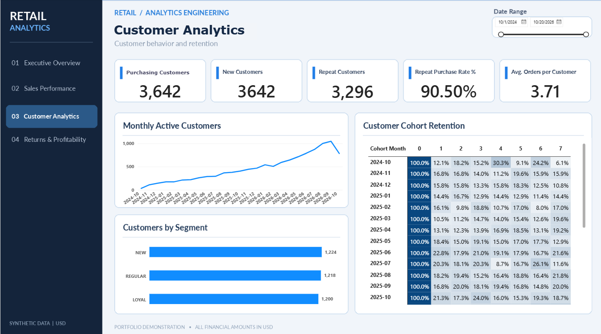
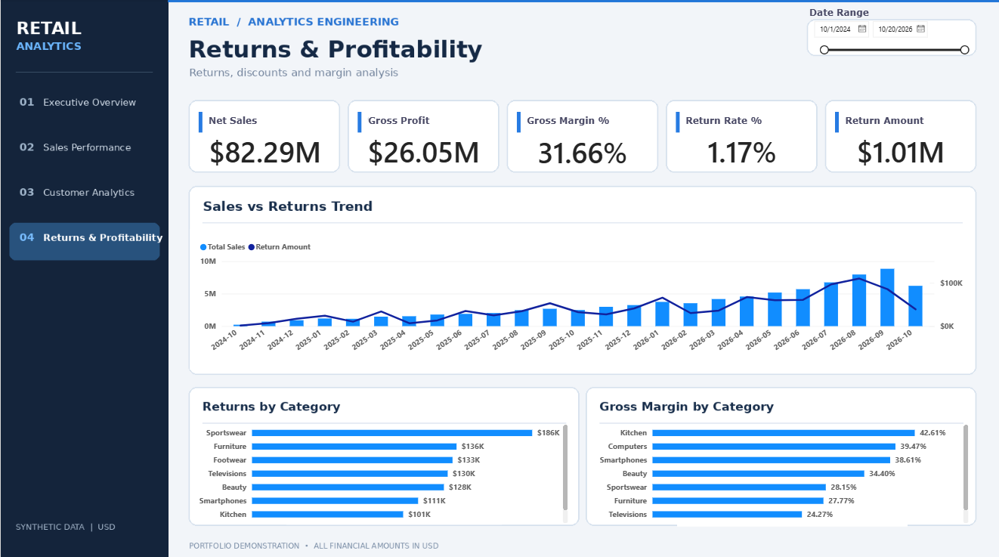

# Retail Analytics Engineering Platform

End-to-End Retail Data Pipeline | Python · PostgreSQL · Docker · dbt · Power BI

## Project Overview

Retail Analytics Engineering Platform is an end-to-end data analytics portfolio project that demonstrates how raw transactional data can be transformed into reliable, business-ready datasets and interactive dashboards.

The platform uses synthetic retail data to simulate a transactional environment covering customers, orders, products, payments, sales channels, stores, and product returns.

The project focuses on:

- Building a reproducible data pipeline
- Transforming transactional data into analytical models
- Applying financial reconciliation and data quality controls
- Measuring sales, profitability, customer behavior, and returns
- Delivering actionable business insights through Power BI

All transactional data is synthetic and intended for demonstration purposes.

## Technology Stack

| Technology | Purpose |
|---|---|
| Python | Synthetic data generation and data loading |
| PostgreSQL | Relational database and analytical storage |
| Docker | Containerized execution environment |
| dbt | SQL transformations, data modeling, and testing |
| SQL | Business logic, aggregations, and validation |
| Power BI | Interactive dashboards and KPI reporting |
| DAX | Financial, customer, and profitability measures |
| PowerShell | Local pipeline orchestration |
| Git & GitHub | Version control and project documentation |

## Architecture

The platform follows a layered analytical architecture:

```text
Synthetic Retail Data
        |
        v
Python Data Generation
        |
        v
PostgreSQL Raw Tables
        |
        v
dbt Staging Models
        |
        v
dbt Intermediate Models
        |
        v
dbt Analytical Marts
        |
        v
Power BI Semantic Model
        |
        v
Interactive Business Dashboards
```

Docker provides the local execution environment, while PowerShell scripts simplify pipeline execution.

Additional architecture details are available in [Architecture Documentation](docs/architecture.md).

## Dataset

The synthetic dataset includes:

- 15,000 generated orders
- 3,750 customers
- 400 products
- 37,374 generated order items
- 797 return events

These figures represent the reference dataset generated during development. The number of records can change depending on generation parameters.

Not every generated order or order item is necessarily eligible for analytical reporting. The dbt transformation layer applies business rules to determine eligible transactions.

## Data Modeling

The dbt project organizes transformations into three main layers.

### Staging Layer

Standardizes raw source data and prepares consistent structures for downstream transformations.

Examples:

- `stg_orders`
- `stg_order_items`
- `stg_customers`
- `stg_products`
- `stg_payments`
- `stg_returns`

### Intermediate Layer

`int_eligible_orders` applies transaction eligibility rules before sales facts are constructed.

### Analytical Marts

| Model | Purpose |
|---|---|
| `fct_order_items` | Eligible order-item sales, costs, and gross profit |
| `fct_returns` | Return events and completed return measures |
| `dim_customer` | Customer attributes |
| `dim_product` | Product attributes |
| `dim_store` | Store attributes |
| `dim_channel` | Sales channel attributes |
| `mart_sales_daily` | Daily sales performance |
| `mart_customer_cohorts` | Customer acquisition cohorts and monthly retention |

The analytical models are designed to support reusable business measures and dimensional reporting.

## Power BI Dashboards

The reporting solution is organized into four analytical pages.

### 1. Executive Overview

Provides a high-level view of retail business performance.

Key metrics include:

- Total Sales
- Net Sales
- Total Orders
- Average Order Value
- Gross Margin

Visualizations include monthly sales trends and performance by channel and product category.

### 2. Sales Performance

Explores sales performance over time and across retail business dimensions.

The dashboard supports identifying revenue trends and comparing commercial performance.

### 3. Customer Analytics

Focuses on customer acquisition, repeat purchasing, segmentation, and retention.

Key metrics include:

- Active Customers
- New Customers
- Repeat Customers
- Repeat Purchase Rate
- Average Orders per Customer

The page also includes monthly customer activity, customer segments, and a cohort retention matrix.

### 4. Returns & Profitability

Analyzes the financial impact of product returns.

Key metrics include:

- Net Sales
- Gross Profit
- Gross Margin
- Return Rate
- Completed Return Amount

Visualizations include sales versus returns over time, returns by category, and gross margin by category.


### Dashboard Screenshots

**Executive Overview**



**Sales Performance**



**Customer Analytics**



**Returns & Profitability**




### Power BI Report File

The complete interactive Power BI report is available here:

[Download Power BI Dashboard (.pbix)](powerbi/retail_analytics_dashboard.pbix)

The report contains four analytical pages:
- Executive Overview
- Sales Performance
- Customer Analytics
- Returns & Profitability

To refresh the report locally, run the PostgreSQL and dbt pipeline and configure the Power BI data source connection.


## Financial Metrics and Business Rules

Financial reporting follows defined business rules.

```text
Gross Sales = Quantity × Unit List Price

Sales = Quantity × Unit Selling Price

Net Sales = Sales - Completed Return Amount

Gross Profit =
    Gross Profit Before Returns
    - Completed Return Amount
    + Completed Returned Cost

Gross Margin % = Gross Profit / Net Sales

Return Rate % = Completed Returned Units / Units Sold
```

Only completed returns contribute to realized return amounts in financial reporting.

Additional definitions are documented in [Business Rules](docs/business_rules.md).

## Data Quality and Testing

The project implements automated dbt tests covering structural integrity, referential integrity, financial consistency, and customer retention.

### Structural and Referential Tests

- Primary key uniqueness
- Required fields are not null
- Foreign key relationships
- Accepted return status values

### Business Rule Tests

- Eligible order validation
- Order item reconciliation
- Return integrity
- Return amounts not exceeding associated sales
- Customer cohort retention consistency

Custom SQL tests are maintained under `dbt/tests/`.

The latest validated local dbt build completed successfully with 18 models and 31 data tests.

## Repository Structure

```text
retail-analytics-engineering-platform/
|
|-- database/
|   `-- init/
|       `-- 001_schema.sql
|
|-- dbt/
|   |-- models/
|   |   |-- staging/
|   |   |-- intermediate/
|   |   `-- marts/
|   |-- tests/
|   |-- macros/
|   |-- dbt_project.yml
|   `-- profiles.yml
|
|-- docs/
|   |-- architecture.md
|   |-- business_rules.md
|   |-- data_contracts.md
|   `-- quality_and_acceptance.md
|
|-- scripts/
|   |-- container_pipeline.py
|   |-- load_retail_data.py
|   |-- run_data_pipeline.ps1
|   |-- run_dbt.ps1
|   |-- start_database.ps1
|   `-- verify_database.ps1
|
|-- docker-compose.yml
|-- Dockerfile.pipeline
|-- requirements.txt
|-- requirements-dbt.txt
|-- .env.example
`-- README.md
```

## Running the Project

### Prerequisites

- Docker Desktop
- Python
- PowerShell
- Git
- dbt with PostgreSQL adapter

### 1. Clone the repository

```bash
git clone https://github.com/LucasAraujo-Data/retail-analytics-engineering-platform.git
cd retail-analytics-engineering-platform
```

### 2. Configure the environment

Review `.env.example` and configure the required environment variables for local execution.

### 3. Start the database

From PowerShell:

```powershell
.\scripts\start_database.ps1
```

### 4. Generate and load retail data

```powershell
.\scripts\run_data_pipeline.ps1 -Mode rebuild -Orders 15000 -Seed 42
```

### 5. Build dbt models and run tests

```powershell
.\scripts\run_dbt.ps1 -Mode build
```

### 6. Verify database availability

```powershell
.\scripts\verify_database.ps1
```

Power BI Desktop can then connect to the PostgreSQL analytical models to build or refresh the reporting layer.

> Note: The commands above reflect the local project workflow. Review environment configuration and installed dependencies before executing the pipeline on a new machine.

## Key Skills Demonstrated

**Data Engineering & Automation**
- Python-based data generation and loading
- Dockerized PostgreSQL environment
- Repeatable data processing workflows

**Analytics Engineering**
- Modular SQL transformations with dbt
- Fact and dimension modeling
- Automated data quality tests
- Financial reconciliation controls

**Business Intelligence**
- Power BI semantic modeling
- DAX measures
- Executive KPI reporting
- Sales and profitability analysis
- Customer segmentation and cohort retention

## Documentation

- [Architecture](docs/architecture.md)
- [Business Rules](docs/business_rules.md)
- [Data Contracts](docs/data_contracts.md)
- [Quality and Acceptance](docs/quality_and_acceptance.md)

## Project Status

Core data pipeline, analytical models, dbt testing, and four Power BI dashboard pages have been developed and validated locally.

Portfolio documentation and dashboard screenshots are being finalized.

## License

See [LICENSE](LICENSE).
